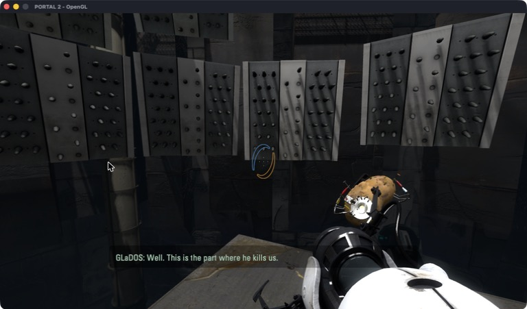
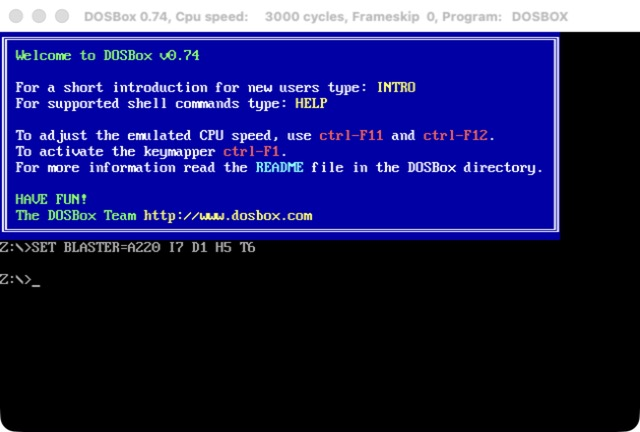

# mac32

Run 32-bit Intel Mac apps and games on current macOS, Apple Silicon included.

macOS stopped running 32-bit apps with Catalina in 2019, and Apple Silicon Macs
never could. mac32 loads such an app into a 64-bit process, runs its code under
Rosetta 2, and passes each call it makes to the 64-bit system libraries. Think of
it as Wine for old Mac apps.

The Mac version of **Portal 2** plays start to finish: graphics, sound, Bink
videos, mouse, keyboard, saves and Steam.



## What runs

| App | Status |
|---|---|
| Portal 2 (Steam) | Plays start to finish. Survives long sessions and quits cleanly. |
| Half-Life (25th anniversary build) | Menu, New Game and maps work. |
| Portal, Half-Life 2 (Nov 2024 Mac builds) | Menus and maps draw. Valve's build cannot make fonts; mac32 patches that in memory (see [Game patches](#game-patches)). Sound and a full playthrough not tested. |
| DOSBox 0.74 | Starts, draws the DOS prompt and starts its sound. Keyboard not tested yet. |
| OpenTTD 1.1.5 | Runs and draws the game. Sound not tested yet; `-s null -m null` turns it off. |
| VLC 1.1.12 | Loads all 268 plugins and shows its main window; cannot open files yet. |
| Firefox 3.6.28 | Starts, then stops at the first old Carbon call mac32 does not have. |

Support for more apps is on the way, starting with ScummVM 1.1.1, Celestia
1.6.1, Tux Paint 0.9.21 and Adium 1.4.5. To see whether an app will run, use
`mac32 check`: it lists the system calls the app needs that mac32 does not
support yet.

<p>


</p>

## Download

Get `Mac32.app` from the [releases page](https://github.com/Shagulka/mac32/releases),
unzip it and move it to Applications. It is not notarized, so the first time,
right-click it and choose Open. You need an Apple Silicon Mac with Rosetta 2, or
an Intel Mac.

## Build from source

You need the Xcode command line tools.

```bash
git clone https://github.com/Shagulka/mac32.git
cd mac32
tools/get-llvm.sh     # LLVM's libunwind and libc++abi sources, about 40 MB
make
make install          # optional: links the mac32 command into ~/.local/bin
```

`make` builds the `mac32` engine, the 32-bit runtime libraries in `guest/`, and
`Mac32.app`, a bundle so macOS treats each program as a normal app. Check it with
`mac32 selftest`.

`make dist VERSION=x.y` packages a release zip in `dist/`. Pushing a tag such as
`v0.2` makes GitHub Actions build, test and publish release 0.2
(`.github/workflows/release.yml`).

## Use it

**From Finder.** Open `Mac32.app` and pick a 32-bit app, drop an app on its
icon, or right-click an app and choose Open With > mac32.

**From the terminal:**

```bash
mac32 run ~/Games/OpenTTD.app
mac32 run "Portal 2"            # a Steam game, by its folder name
```

| Command | What it does |
|---|---|
| `mac32 run <app> [args]` | Run an app bundle, a program file, or a Steam game by its folder name. Also `mac32 <app>`. |
| `mac32 check <app>` | Is it 32-bit? Which of its imports does mac32 not cover yet? |
| `mac32 scan [folders]` | Find 32-bit apps in Applications, Downloads, Desktop and your Steam library. |
| `mac32 config <app> set args=... / cwd=... / env=NAME=VALUE` | Settings kept for that app, like `winecfg`. |
| `mac32 wrap <app>` | Make a launcher in `~/Applications/mac32` with the app's name and icon, for the Dock or Launchpad. |
| `mac32 logs [app]` | Follow a program's log (`~/Library/Logs/mac32-<name>.log`). |
| `mac32 selftest` | Check mac32 itself. |

For a Steam game, Steam must be running and logged in. Steam checks that you own
the game; mac32 does not touch that check. `MOD=<folder>` picks the game folder
when a Source game holds more than one.

## How it works

- **32-bit code in a 64-bit process.** Rosetta 2 still runs 32-bit x86 code if
  the process sets up a 32-bit code segment. mac32 adds one to the process's
  local descriptor table and switches with `iretq` (in) and a far return (out).
- **Low memory.** The program must live below 4 GB. The mac32 binary reserves
  that range when it is linked and hands out pages and heap blocks from it,
  reusing freed ranges.
- **Loader.** Reads i386 Mach-O files: segments, rebases, binds (classic and
  `LC_DYLD_INFO`), lazy symbols, initializers, `LC_MAIN` and `LC_UNIXTHREAD`.
- **Bridges.** Each imported function becomes a small 32-bit stub that switches
  to 64-bit code. The host side reads the 32-bit arguments, converts them
  (`long` and pointers are 4 bytes, `CGFloat` is a float, structs differ), calls
  the real 64-bit function and converts the result back. Over 3,300 functions
  are covered: libc, pthreads, CoreFoundation, CoreGraphics, Carbon, IOKit,
  OpenGL, OpenAL, AudioQueue, AudioUnit, Sound Manager, zlib and more. Much of
  CoreGraphics, CoreFoundation and Carbon is generated from the SDK headers by
  `tools/gen_api.py`. A call costs about 55 ns.
- **Objective-C.** The old i386 runtime differs from the 64-bit one. Classes the
  program defines become real 64-bit subclasses whose methods call back into
  32-bit code; messages to system objects go through `NSInvocation` with their
  types converted. ARC calls, blocks, categories and `@try`/`@throw` are bridged.
- **C++.** A 32-bit build of LLVM's libunwind and libc++abi gives programs
  exceptions and RTTI. The old GNU `std::string` and iostreams are rewritten to
  match GCC 4's memory layout, since old programs build parts of them inline.
- **Steam.** The game's own 32-bit `libsteam_api` talks to the running 64-bit
  Steam client through mac32, which stands in for each interface. Method slots
  are measured from the game's library when it loads.

For the full story of how each part was built, see the
[development journal](docs/journal.md).

## Game patches

Some old Mac builds have bugs that would stop them on any Mac. mac32 fixes those
in memory when the library loads; the files on disk never change. Each patch
lives in `patches/`, one file per game library, and runs only on the exact build
it was written for (SHA-256 of the library's i386 code), so a fixed build from
the vendor is left alone. `MAC32_NOPATCH=1` turns them all off.

| Game | Library and build | What is wrong | What the patch does |
|---|---|---|---|
| Half-Life 2, Portal (Nov 25 2024 Mac builds) | `bin/vguimatsurface.dylib`, SHA-256 `6d5d9660de74…` | Font creation was compiled out: `CFontManager::CreateOrFindWin32Font` stores a NULL font and the next lookup crashes. The leftover `COSXFont` class does not match the font interface the rest of the library uses, so no font could ever be made. | Replaces that function with one that makes mac32's own fonts, drawn with CoreText (`src/srcfont.m`), and registers the game's own `.ttf` files. |

## Troubleshooting

`mac32 run -v` writes a detailed log. If an app calls a system function mac32
does not support yet, mac32 stops and logs the function's name with a stack
trace.

| Setting | Effect |
|---|---|
| `mac32 run --trace name,... <app>` | Log calls and messages whose names contain these (`MAC32_TRACE` with the engine's `-t`) |
| `MAC32_MEMSTATS=30` | Log 32-bit address space use every 30 seconds |
| `MAC32_JOINLOG=1` | Log thread joins and where a stuck thread waits |
| `MAC32_HEAPCHECK=1` | Poison freed blocks to catch writes after free |
| `MAC32_NOPATCH=1` | Turn the game patches off (to tell a loader bug from a patch bug) |

## Project layout

| Folder | What is in it |
|---|---|
| `bin/mac32` | The command-line tool |
| `src/` | The 64-bit engine: loader, mode switch, memory, and the bridges to macOS |
| `guest/` | 32-bit runtime libraries loaded into every program (C++ runtime, strings, streams) |
| `patches/` | Fixes for bugs in specific game builds |
| `tools/` | Bridge generators, test helpers, and the first Rosetta probe |
| `third_party/` | Steamworks interface descriptions (MIT) |
| `docs/` | The journal, screenshots and the project page |

## Contributing

The most helpful thing is a report on how an app runs. Open an issue with the
app's name and version, where you got it, the output of `mac32 check --all <app>`
and the end of its log. To add support for a missing function, see
[CONTRIBUTING.md](CONTRIBUTING.md).

## Known limitations

- Games run in single-player or on your own servers. mac32 does not touch
  anti-cheat or ownership checks.
- mac32 does not include any games or Apple files; you use your own copies.
- Game controllers, voice input and QuickTime video are not supported yet.
- Signals are not delivered to 32-bit code.

## Credits and license

Made by Boris Khesin, with [Claude](https://claude.com/claude-code) (Anthropic)
as a contributor. Licensed under the [GNU General Public License, version 3 or
later](COPYING); see [NOTICE](NOTICE).

- Steam interface descriptions in `third_party/` come from
  [Steamworks.NET](https://github.com/rlabrecque/Steamworks.NET) (MIT); see
  `third_party/README.md`.
- The guest C++ runtime is built from LLVM libunwind and libc++abi
  (Apache-2.0 with LLVM exception).

Portal, Half-Life, Source and Steam are trademarks of Valve Corporation; Mac and
macOS are trademarks of Apple Inc. This project is not made or endorsed by
either.
