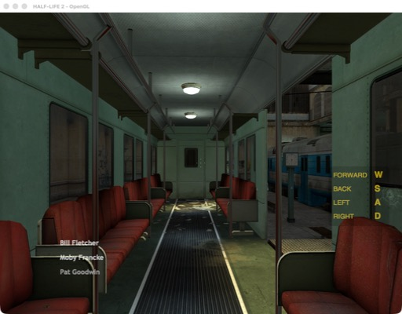

# mac32

Run 32-bit Intel Mac programs on a modern Mac.

macOS dropped 32-bit apps in 2019 (Catalina), and Apple Silicon Macs never ran
them. mac32 loads a 32-bit Mach-O program into a 64-bit process under Rosetta 2,
runs its own code as is, and answers each call it makes into macOS with the
64-bit version of that call. No emulator, no virtual machine, no Windows build.

It was made to play the Mac version of **Portal 2**, and that works in full:
graphics, sound, Bink videos, mouse, keyboard, saves and Steam.




## Status

| Program | State |
|---|---|
| Portal 2 (Steam, app 620) | Plays start to finish. Survives long sessions and quits cleanly. |
| Half-Life (25th anniversary build) | Reaches the menu and loads maps. An occasional crash in SDL's text input is still open. |
| OpenTTD 1.1.5 (Mac OS X 10.4-era build) | Runs and draws the game; sound and music not bridged yet (`mac32 config OpenTTD.app set "args=-s null -m null"`). |
| VLC 1.1.12 | Loads all 268 plugins and shows its main window; opening files does not work yet. |
| Portal, Half-Life 2 (Nov 2024 builds) | Main menu and maps load and render (test chamber 00, the opening train ride). Valve's 2024 Mac build cannot make fonts; mac32 patches that in memory and draws them with CoreText. Sound and a full playthrough are not tested yet. |

Other 32-bit Source and GoldSrc games are the next targets. Anything else
32-bit will hit calls mac32 does not cover yet; the loader names each one.

## How it works

- **32-bit code in a 64-bit process.** Rosetta 2 still runs 32-bit x86 code if
  the process sets up a 32-bit code segment. mac32 adds one to the process's
  local descriptor table and switches with `iretq` (in) and a far return (out).
- **Low memory.** The program must live below 4 GB. The mac32 binary reserves
  that range at link time (a `__RESERVE` segment) and hands out pages and heap
  blocks from it, reusing freed ranges.
- **Loader.** Parses i386 Mach-O: segments, rebases, binds (classic and
  `LC_DYLD_INFO`), lazy symbols, initializers, `LC_MAIN` and `LC_UNIXTHREAD`.
- **Thunks.** Each imported function becomes a small 32-bit stub that switches to
  64-bit code. The host side reads the 32-bit arguments, converts them (`long` and
  pointers are 4 bytes, `CGFloat` is a float, structs differ), calls the real
  64-bit function and converts the result. About 2,100 functions are covered (half of them OpenGL):
  libc, pthreads, CoreFoundation, CoreGraphics, Carbon, IOKit, OpenGL, OpenAL,
  AudioQueue, Sound Manager, zlib and more. A call costs about 55 ns.
- **Objective-C.** The old i386 runtime differs from the 64-bit one. Classes the
  program defines become real 64-bit subclasses whose methods forward back into
  32-bit code; messages to system objects go through `NSInvocation` with types
  converted. ARC calls, blocks, categories and `@try`/`@throw` are bridged.
- **C++.** A 32-bit build of LLVM's libunwind and libc++abi gives the program
  exceptions and RTTI. The old GNU `std::string` is rewritten from its ABI.
- **Steam.** The game's own 32-bit `libsteam_api` talks to the running 64-bit
  Steam client through mac32, which proxies each interface. Method slots are
  measured from the game's library at run time. Steam still checks that you own
  the game; mac32 does not change that.

## Requirements

- An Apple Silicon Mac with Rosetta 2, or an Intel Mac.
- Xcode command line tools (clang).
- For C++ exceptions in the guest: an LLVM 17.0.6 checkout (only `libcxx`,
  `libcxxabi` and `libunwind` are needed) at `~/Developer/mac32-deps/llvm-project`,
  or set `LLVM=` to its path.
- The game, bought and installed through Steam, and Steam running and logged in.

## Build

```bash
make
```

This builds `mac32`, the 32-bit runtime libraries in `guest/`, and `Mac32.app`
(a bundle so macOS treats the game as a normal app). `./mac32 --selftest
guest/selftest.dylib` checks mode switches, callbacks, exceptions and memory reuse.

## Use it

mac32 works like `wine`, for old Mac apps.

**From Finder.** Double-click `Mac32.app` and pick a 32-bit app, drop an app on
its icon, or right-click an app and choose Open With > mac32.

**From the terminal** (`make install` links the `mac32` command into
`~/.local/bin`; or run `bin/mac32` from here):

```bash
mac32 run ~/Games/OpenTTD.app
```

| Command | What it does |
|---|---|
| `mac32 run <app> [args]` | Run an app bundle, a program file, or a Steam game by its folder name (`mac32 run "Portal 2"`). Also `mac32 <app>`. |
| `mac32 check <app>` | Is it 32-bit? Which of its imports does mac32 not cover yet? |
| `mac32 scan [folders]` | Find 32-bit apps in Applications, Downloads, Desktop and your Steam library. |
| `mac32 config <app> set args=... / cwd=... / env=NAME=VALUE` | Settings kept for that app, like `winecfg`. |
| `mac32 wrap <app>` | Make a launcher in `~/Applications/mac32` with the app's name and icon, for the Dock or Launchpad. |
| `mac32 logs [app]` | Follow a program's log (`~/Library/Logs/mac32-<name>.log`). |
| `mac32 selftest` | Check mac32 itself. |

For a Steam game, Steam must be running and logged in; Steam checks that you
own the game.

Useful settings:

| Variable | Effect |
|---|---|
| `MAC32_MEMSTATS=30` | Log 32-bit address space use every 30 seconds |
| `MAC32_TRACE=name,...` | With `-t`, trace calls and messages whose names contain these |
| `MAC32_JOINLOG=1` | Log thread joins and where a stuck thread waits |
| `MAC32_HEAPCHECK=1` | Poison freed blocks to catch writes after free |

## Limits

- Only single-player and your own servers. mac32 does not touch anti-cheat or
  ownership checks, and it ships no game files.
- Game controllers, voice input and QuickTime video are not bridged yet.
- Signals are not delivered to 32-bit code.

## Credits and license

Made by Boris Khesin, with [Claude](https://claude.com/claude-code) (Anthropic) as a contributor.
Licensed under the [GNU General Public License, version 3 or later](COPYING); see
[NOTICE](NOTICE). Keep the copyright notice when you share or change it.

- Steam interface descriptions in `third_party/` come from
  [Steamworks.NET](https://github.com/rlabrecque/Steamworks.NET) (MIT); see
  `third_party/README.md`.
- The guest C++ runtime is built from LLVM libunwind and libc++abi
  (Apache-2.0 with LLVM exception).

Portal, Half-Life, Source and Steam are trademarks of Valve Corporation. This
project is not made or endorsed by Valve.
